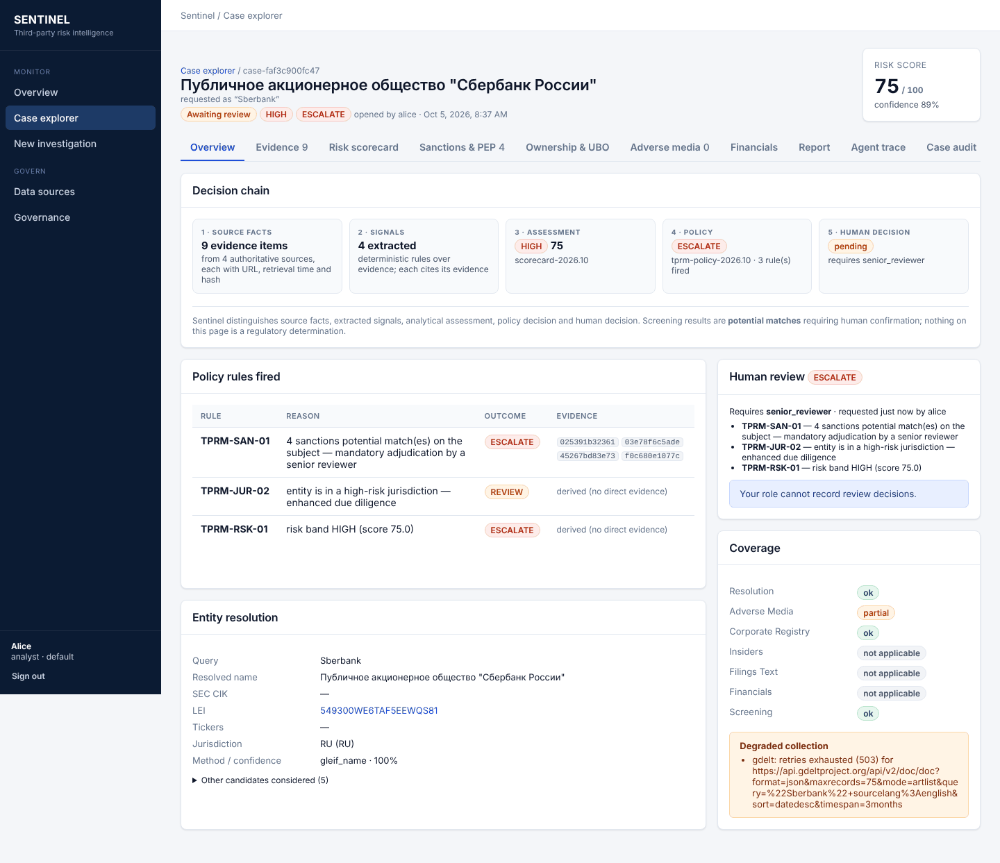
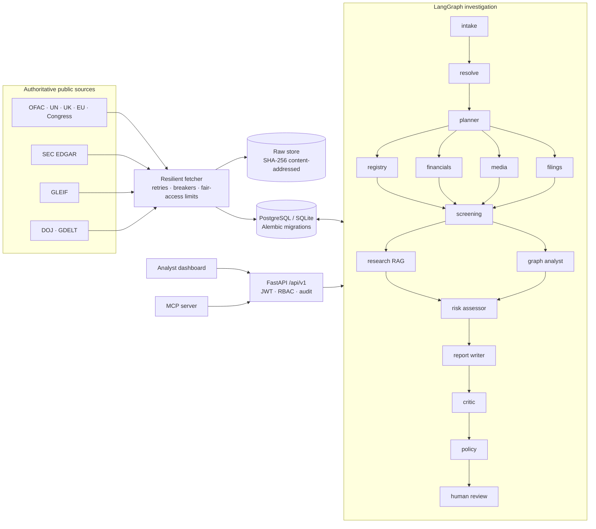

# Sentinel — Due-Diligence & Third-Party Risk Intelligence

Sentinel investigates a company before a business relationship is approved. It resolves the legal entity, collects
evidence from authoritative public sources, screens the entity and its related parties against official sanctions and
PEP lists, analyses ownership, filings, financials and enforcement history, produces an explainable risk assessment,
applies a deterministic onboarding policy and routes the case to a human reviewer who records the final decision.

It is an independent, open-source engineering project with a production-grade architecture. It is **not** a
certified compliance product, it has not been deployed at a regulated institution, and it does not make regulatory
determinations: screening results are *potential matches* that a qualified person must adjudicate.



---

## What it does

| Step | What happens | Sources |
|---|---|---|
| Resolve | Match the requested name/CIK/LEI/ticker to registry records, flag ambiguity | SEC EDGAR company index, GLEIF LEI |
| Collect (parallel) | Corporate registry & ownership, Exhibit 21 subsidiaries, Form 3/4 insiders, 10-K sections, XBRL financials, enforcement & news | GLEIF Level 2, SEC EDGAR, DOJ press releases, GDELT |
| Screen | Subject + related parties against official lists (name, alias and identifier matching) | OFAC SDN, UN SC, UK Sanctions List, EU FSF, US Congress (PEP) |
| Analyse | Evidence-backed relationship graph and exposure paths, cited research Q&A, adverse-media subject-role classification, peer anomaly model | stored evidence only |
| Assess | Versioned scorecard: every factor has its value, rule, points, cap and evidence ids | persisted signals |
| Decide | Deterministic policy rules → AUTO_CLEAR (off by default) / REVIEW / ESCALATE; maker-checker human review with mandatory rationale | — |
| Audit | Hash-chained, append-only audit log of every security-relevant action | — |

Every piece of evidence keeps its source, URL, retrieval timestamp, content hash, locator and confidence, and the
raw bytes are kept in a content-addressed store so any evidence item can be traced back to what was downloaded.
The layers **Source fact → Extracted signal → Analytical assessment → Policy decision → Human decision** are stored
in separate tables and shown separately in the dashboard.

## Quick start (local, SQLite)

Requirements: Python 3.11+, Node 20+ (only to build the dashboard).

```bash
python -m venv .venv && . .venv/bin/activate
pip install -e ".[dev]"
cp .env.example .env                       # set SENTINEL_SEC_USER_AGENT to a real contact (SEC policy)
(cd dashboard && npm ci && npm run build)  # analyst dashboard, served by the API at /

sentinel db upgrade                        # create/upgrade the schema (Alembic)
sentinel sources refresh --all             # download the official sanctions / PEP lists (live, ~1 min)
sentinel ml train --year 2024              # peer model on SEC XBRL frames (live, optional)
SENTINEL_NEW_PASSWORD='choose-a-long-password' sentinel users create --username alice --roles analyst
SENTINEL_NEW_PASSWORD='another-long-password'  sentinel users create --username bob --roles reviewer

uvicorn sentinel.api.main:create_app --factory --port 8000
# open http://localhost:8000  (API reference: http://localhost:8000/api/docs)
```

Production-like stack with PostgreSQL: see [docs/deployment.md](docs/deployment.md) (`docker compose up -d`).

## Verify it

```bash
pytest                                     # offline suite on recorded real source data (+ browser e2e if built)
pytest --cov=sentinel                      # coverage gate: 80 %
sentinel eval                              # offline release gates (screening, media roles, retrieval, routing, grounding, injection)
sentinel eval --screening-live             # screening recall / false-positive rate against the full loaded lists
pytest -m live                             # live smoke tests against the real upstream sources
ruff check src tests scripts && mypy src && bandit -r src -ll
```

Results of the runs used for this release, and how they were produced, are in
[docs/evaluation.md](docs/evaluation.md).

## Architecture



Details: [docs/architecture.md](docs/architecture.md).

## Documentation

| Topic | Document |
|---|---|
| Architecture, components, data flow | [architecture.md](docs/architecture.md) |
| Deployment (Docker, Compose, Kubernetes) | [deployment.md](docs/deployment.md) |
| Configuration reference | [configuration.md](docs/configuration.md) |
| Data sources, licences, limitations | [data_sources.md](docs/data_sources.md) |
| Data lineage & quality | [data_lineage.md](docs/data_lineage.md) |
| Security controls | [security.md](docs/security.md) |
| Threat model | [threat_model.md](docs/threat_model.md) |
| AI / LLM governance | [ai_governance.md](docs/ai_governance.md) |
| Model card (scorecard, peer model, screening, media classifier) | [model_card.md](docs/model_card.md) |
| Evaluation methodology & results | [evaluation.md](docs/evaluation.md) |
| REST API | [api.md](docs/api.md) |
| Analyst dashboard | [dashboard.md](docs/dashboard.md) |
| Operations runbook | [runbook.md](docs/runbook.md) |
| Backup & disaster recovery | [disaster_recovery.md](docs/disaster_recovery.md) |
| Limitations & known risks | [limitations.md](docs/limitations.md) |
| Developer setup | [development.md](docs/development.md) |
| Business case | [business_case.md](docs/business_case.md) |
| Changes from v1 (gap analysis) | [gap_analysis.md](docs/gap_analysis.md) |
| Architecture decisions | [adr/](docs/adr) |

## Repository layout

```
src/sentinel/
  sources/        connectors, resilient HTTP, raw store, lineage fetcher, record/replay
  ingestion/      reference-list loads (validation, DQ checks, versioning, freshness), chunking
  investigation/  entity resolution, evidence writer, collectors
  screening.py    sanctions / PEP matching
  risk/           scorecard, financial indicators, adverse-media taxonomy, jurisdictions, peer model
  governance/     onboarding policy engine
  agents/         LangGraph workflow, nodes, agent contracts, case service, tool registry, Claude agent
  rag/ graphrag/  per-case hybrid retrieval and grounding; evidence-backed relationship graph
  llm/            extractive default + Anthropic / OpenAI / Bedrock / Vertex clients, metering, routing
  security/       JWT, RBAC, users & passwords, DLP, guardrails, hash-chained audit
  db/             SQLAlchemy models and Alembic migrations
  api/ mcp_server/ cli.py eval/ ml/ observability/ finetune/ (research module, not in the decision path)
dashboard/        React + TypeScript analyst dashboard
tests/            unit · integration · API e2e · browser e2e · live (opt-in); fixtures = recorded real responses
infra/            Docker entrypoint, Kubernetes manifests, Prometheus config
docs/             documentation (see table above)
```

## Licence

MIT for the code. Source data keeps its own licence — see [docs/data_sources.md](docs/data_sources.md).
