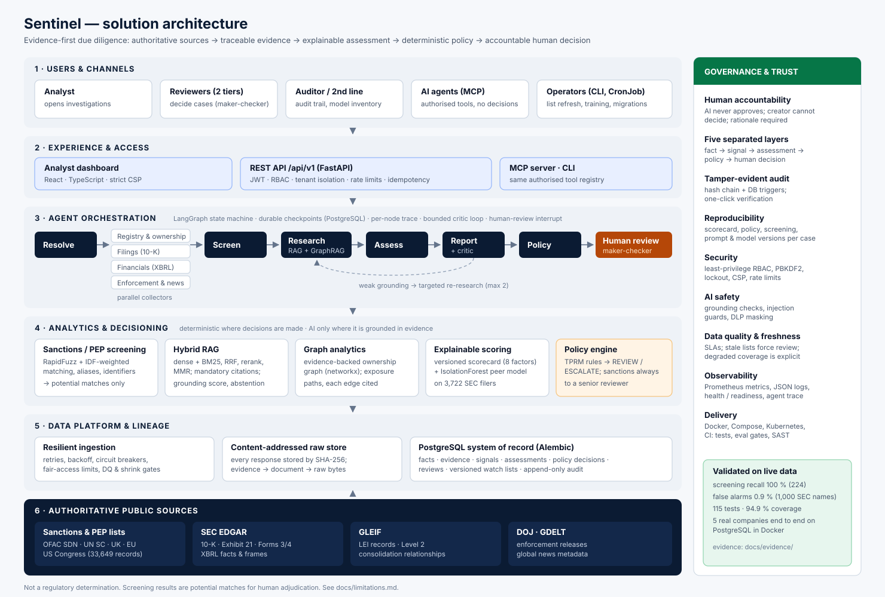
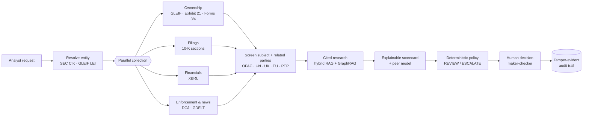
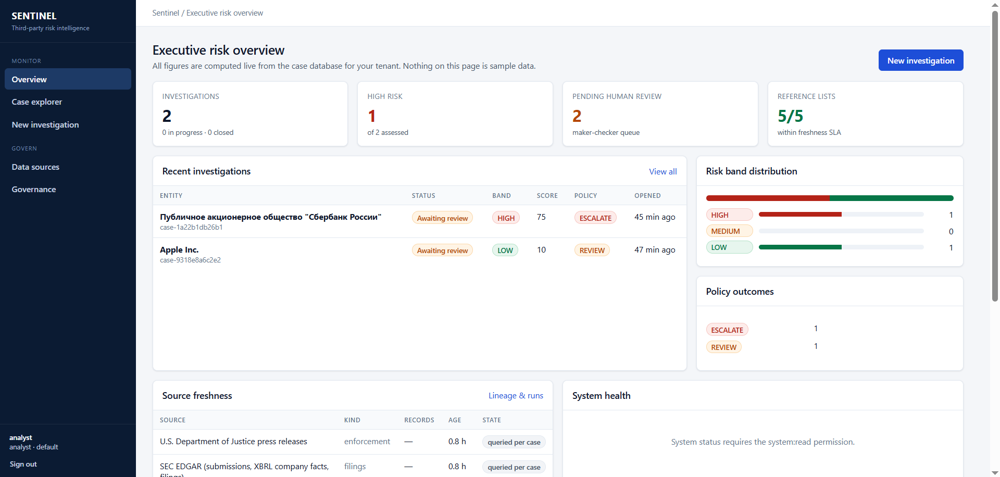
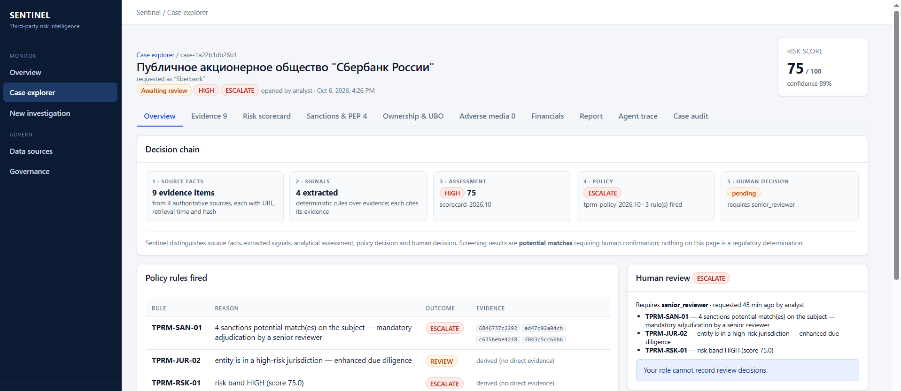
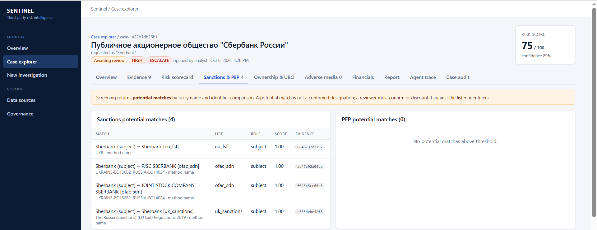

# Sentinel

### Evidence-first due diligence and third-party risk intelligence


Sentinel turns days of manual supplier and counterparty vetting into a **cited, auditable evidence file** built
from authoritative government and registry data, and leaves the onboarding decision with an accountable human.

> **Scope.** Independent engineering project with a production-grade architecture, validated end to end on live
> public data. It is not a certified compliance product, has not been deployed at a regulated institution, and does
> not make regulatory determinations. Screening results are *potential matches* for qualified human review.

---

## Executive summary

| | |
|---|---|
| **Problem** | Banks, insurers and large enterprises must vet every supplier, vendor and corporate customer before onboarding (sanctions, ownership, enforcement history, financial health). The work is manual, slow, inconsistent between analysts and hard to evidence to regulators. |
| **Solution** | A governed multi-agent workflow that resolves the legal entity, collects evidence from official sources in parallel, screens the entity and its related parties, scores risk with an explainable scorecard, applies deterministic policy rules and routes every case to a human reviewer. |
| **Design principle** | AI gathers and organises evidence; **rules and people make decisions**. Every finding traces back to the downloaded source document. |
| **Validation** | Run end to end on live data in Docker with PostgreSQL: 33,649 official list records, 5 real companies, 100 % screening recall on 224 perturbed list names, 0.9 % false alarms on 1,000 real SEC registrants, 114 automated tests at 94.8 % coverage ([evidence](docs/evaluation.md)). |

---

## The business problem

Third-party due diligence is a regulatory obligation (sanctions, anti-money-laundering, anti-bribery, supply-chain
rules) and a material operational cost. For every counterparty an analyst typically has to:

1. confirm **who the entity legally is** (registry identifiers, legal name, jurisdiction);
2. establish **who owns and controls it** (parents, subsidiaries, officers, directors);
3. **screen** it and its related parties against multiple sanctions and politically-exposed-person lists;
4. review **enforcement actions, litigation and adverse news**;
5. assess **financial health**;
6. write a memo and obtain a **sign-off** that can be defended to auditors and regulators.

| Pain point | Consequence | How Sentinel addresses it |
|---|---|---|
| Manual research across many sources | Long cycle times, analyst cost | Parallel automated collection from official sources |
| Analyst-to-analyst variation | Inconsistent outcomes | Same versioned scorecard and policy on every case |
| Weak evidence trail | Audit and regulatory findings | Every claim cited; raw source bytes retained and hash-verified |
| Indirect exposure missed (subsidiary, director) | Sanctions breaches | Related-party screening and evidence-backed exposure paths |
| Over-reliance on AI output | Unaccountable decisions | AI never decides; maker-checker human review with mandatory rationale |

See [docs/business_case.md](docs/business_case.md) for stakeholders, KPIs and a phased rollout plan.

---

## Solution architecture



**How one case flows**



**Five layers that are never blurred** — each stored separately and shown separately to the reviewer:

| Layer | Example |
|---|---|
| 1. Source fact | "OFAC SDN list (retrieved 2026-10-05, SHA-256 …) lists SBERBANK OF RUSSIA" |
| 2. Extracted signal | sanctions potential match, score 1.0, evidence id `409ec19b…` |
| 3. Analytical assessment | scorecard-2026.10: 75 / 100, band HIGH, factor-by-factor breakdown |
| 4. Policy decision | tprm-policy-2026.10: ESCALATE (rule TPRM-SAN-01) → senior reviewer required |
| 5. Human decision | rejected by a senior reviewer, with timestamp and written rationale |

Details: [docs/architecture.md](docs/architecture.md).· [data lineage](docs/data_lineage.md) ·
[architecture decisions](docs/adr).

---

## Results on live data

All figures come from runs whose raw output is stored in [`docs/evidence/`](docs/evidence).

| Measure | Result |
|---|---|
| Official list records loaded and versioned | 33,649 (OFAC 19,488 · UK 6,370 · EU 6,241 · UN 1,011 · US Congress 539) |
| Screening recall (224 real list names with spelling/word-order variations) | **100 %** |
| False alarms on 1,000 real SEC registrant names | **0.9 %** (improved from 2.5 % by IDF-weighted matching) |
| Peer model | IsolationForest on 3,722 SEC filers; all quality gates passed |
| Automated tests | 114 passed, 0 skipped · 94.8 % coverage · browser end-to-end included |
| Offline evaluation gates | all passed (screening, media-role accuracy 0.958, retrieval, routing, grounding, prompt injection) |
| Security & supply chain | 0 medium/high SAST findings · 0 known vulnerabilities in 113 Python packages and dashboard dependencies |

**Live end-to-end run (Docker + PostgreSQL)**

| Company | Band / score | Outcome | Why |
|---|---|---|---|
| Apple Inc. | LOW / 10 | Review | All checks clean; policy requires human sign-off |
| The Boeing Company | MEDIUM / 33 | Review | DOJ enforcement history as subject; one PEP name match for a reviewer to discount |
| Sberbank | HIGH / 75 | **Escalate** | Potential matches on OFAC, EU and UK sanctions lists; high-risk jurisdiction |
| Siemens AG | LOW / 0 | Review | Non-SEC entity; registry and screening coverage only |
| Microsoft Corp | LOW / 22 | Review | Enforcement items classified by role (subject / victim / mentioned) |

---

## Product

| Executive overview | Sberbank case overview |
|---|---|
|  |  |

| Sberbank sanctions & PEP |
|---|
|  |

More: [docs/dashboard.md](docs/dashboard.md).

---

## Governance and responsible AI

- **Humans decide.** Auto-clear is off by default; the analyst who opened a case cannot decide it; sanctions
  matches always go to a senior reviewer; every decision needs a written rationale.
- **AI cannot invent facts.** The default language engine is extractive (selects and cites source sentences);
  optional generative providers (Claude, OpenAI, Bedrock, Vertex) must pass the same grounding check.
- **Reproducible.** Scorecard, policy, screening, media-taxonomy, jurisdiction-policy, prompt and model versions are
  recorded with every assessment.
- **Tamper-evident.** Hash-chained audit log; the database rejects edits and deletes; one-click verification.
- **Secure by default.** Least-privilege roles, PBKDF2 passwords with lockout, token revocation, strict CSP,
  rate limits, DLP masking, prompt-injection guards.

[Security](docs/security.md) · [threat model](docs/threat_model.md) · [AI governance](docs/ai_governance.md) ·
[model card](docs/model_card.md)

---

## Technology

| Capability | Technology |
|---|---|
| Agent orchestration | LangGraph (parallel steps, durable checkpoints, human-review interrupt) |
| API & security | FastAPI · JWT · role-based access · rate limiting · CSP |
| Data | PostgreSQL / SQLite · SQLAlchemy 2.0 · Alembic · content-addressed raw store |
| Retrieval & reasoning | Hybrid RAG (dense + BM25, RRF, rerank, MMR) · GraphRAG (networkx) · grounding checks |
| Screening & ML | RapidFuzz with IDF weighting · scikit-learn IsolationForest · PSI drift monitoring |
| LLM providers | Extractive (default, no external calls) · Anthropic Claude · OpenAI · AWS Bedrock · Google Vertex |
| Agent interoperability | Model Context Protocol (MCP) server with authorised tools |
| Front end | React · TypeScript · Vite |
| Delivery | Docker · Docker Compose · Kubernetes manifests · GitHub Actions |
| Quality | pytest · Playwright · ruff · mypy · bandit · pip-audit · npm audit · Prometheus metrics |

---

## Quick start

Requirements: Python 3.11+, Node 20+ (to build the dashboard).

```bash
python -m venv .venv && . .venv/bin/activate
pip install -e ".[dev]"
cp .env.example .env                        # set SENTINEL_SEC_USER_AGENT to a real contact (SEC policy)
(cd dashboard && npm ci && npm run build)   # analyst dashboard, served by the API at /

sentinel db upgrade                         # create the schema
sentinel sources refresh --all              # download the official sanctions / PEP lists (~1 min)
sentinel ml train --year 2024               # optional: peer model on SEC data
SENTINEL_NEW_PASSWORD='…' sentinel users create --username alice --roles analyst
SENTINEL_NEW_PASSWORD='…' sentinel users create --username bob   --roles reviewer

uvicorn sentinel.api.main:create_app --factory --port 8000
# http://localhost:8000   (API reference: /api/docs)
```

Production-like stack with PostgreSQL: `docker compose up -d` — see [docs/deployment.md](docs/deployment.md).

### Verify

```bash
pytest --cov=sentinel                       # offline suite on recorded real data (+ browser e2e when built)
sentinel eval                               # release evaluation gates
sentinel eval --screening-live              # screening against the full loaded lists
pytest -m live                              # smoke tests against the real upstream sources
ruff check src tests scripts && python -m mypy src scripts && bandit -r src scripts -ll
```

---

## Limitations and roadmap

Known limitations are documented rather than hidden — see [docs/limitations.md](docs/limitations.md). The main ones:

| Area | Today | Next step |
|---|---|---|
| Beneficial ownership | GLEIF consolidation, Exhibit 21, Forms 3/4 (not a UBO register) | National UBO registers (e.g. UK Companies House PSC) |
| PEP coverage | US Congress | Licensed global PEP dataset |
| Adverse media | DOJ releases; GDELT often throttled | Commercial news / risk-intelligence feed |
| Scale-out | In-process case runner, per-process rate limits | Distributed job queue, gateway rate limiting |
| Identity | Local accounts + JWT | SSO (OIDC/SAML) and MFA |
| Scoring calibration | Expert-set weights | Calibrate against historical decisions |

---

## Documentation

| Topic | Document |
|---|---|
| Architecture · data lineage · decisions | [architecture](docs/architecture.md) · [lineage](docs/data_lineage.md) · [ADRs](docs/adr) |
| Deployment · configuration · runbook · DR | [deployment](docs/deployment.md) · [configuration](docs/configuration.md) · [runbook](docs/runbook.md) · [DR](docs/disaster_recovery.md) |
| Data sources and licences | [data_sources](docs/data_sources.md) |
| Security · threat model · AI governance · model card | [security](docs/security.md) · [threats](docs/threat_model.md) · [AI governance](docs/ai_governance.md) · [model card](docs/model_card.md) |
| Evaluation results | [evaluation](docs/evaluation.md) |
| API · dashboard · development | [API](docs/api.md) · [dashboard](docs/dashboard.md) · [development](docs/development.md) |
| Business case · limitations · v1 → v2 | [business case](docs/business_case.md) · [limitations](docs/limitations.md) · [gap analysis](docs/gap_analysis.md) |

## Repository layout

```
src/sentinel/      sources · ingestion · investigation · screening · risk · governance · agents
                   rag · graphrag · llm · security · db · api · mcp_server · cli · eval · ml
dashboard/         React + TypeScript analyst dashboard
tests/             unit · integration · API e2e · browser e2e · live (opt-in); fixtures = recorded real responses
infra/             Docker entrypoint · Kubernetes manifests · Prometheus config
docs/              documentation, evaluation evidence, screenshots, architecture decisions
```

## License

MIT for the code. Source data remains under its publishers' terms — see [docs/data_sources.md](docs/data_sources.md).

**Author:** Shraddha Todkari
