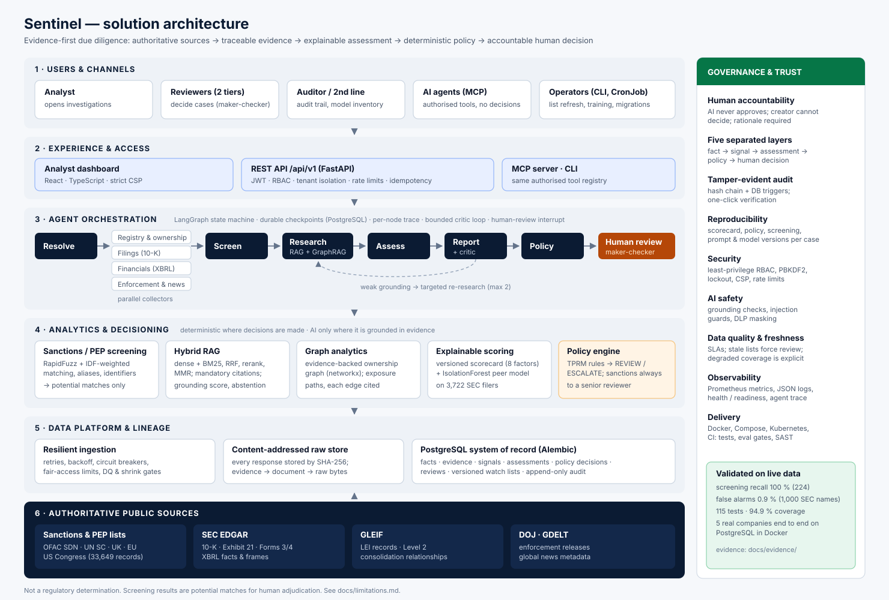
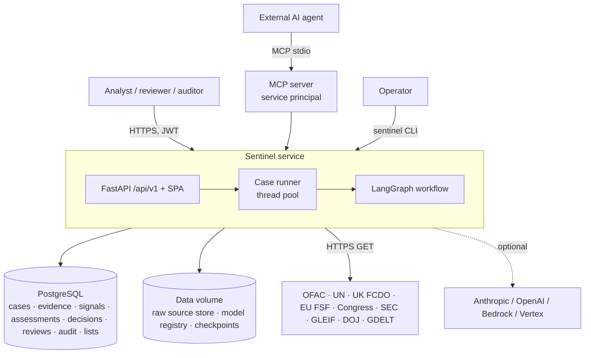
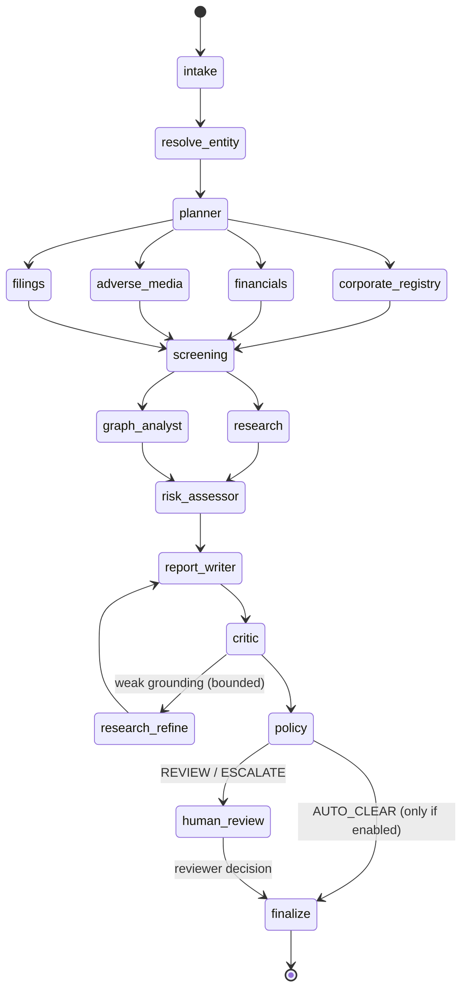

# Architecture

## 1. Context

Sentinel is a single deployable service (API + background runner + static dashboard) backed by a relational database
and a file/volume store. It pulls data from public, authoritative sources over HTTPS and optionally calls an LLM
provider. Operators interact through the CLI; analysts, reviewers and auditors through the dashboard; other agents
through the MCP server.

## 2. Data layers

The system keeps five layers in separate tables and never collapses them:

| Layer | Table | Produced by | Example |
|---|---|---|---|
| Source fact | `source_documents` (+ raw store), `evidence`, `watchlist_entries`, `relationships` | connectors, collectors | "GLEIF reports APPLE OPERATIONS INTERNATIONAL as directly consolidated by Apple Inc." |
| Extracted signal | `signals` | deterministic rules over evidence | `sanctions_potential_match` (score 1.0, OFAC SDN entry …) |
| Analytical assessment | `risk_assessments` | versioned scorecard | `scorecard-2026.10`: 75 / HIGH, factor breakdown |
| Policy decision | `policy_decisions` | versioned rule engine | `tprm-policy-2026.10`: ESCALATE (TPRM-SAN-01, …) |
| Human decision | `reviews` | authorised reviewer | rejected by `sara` (senior_reviewer) with rationale |

`audit_events` records who did what to each of them.

## 3. Components

| Package | Responsibility |
|---|---|
| `sources/http.py` | `ResilientHttpClient`: timeouts, bounded retries with exponential backoff + jitter, `Retry-After`, per-host minimum interval (SEC 10 req/s, GDELT 1 req/5 s), per-host circuit breakers, metrics. Failures raise typed exceptions. |
| `sources/fetcher.py`, `raw_store.py` | Lineage fetcher: every response is stored gzip-compressed under its SHA-256 and registered as a `SourceDocument` (URL, status, content type, size, retrieval time). Per-entity responses are reused within a cache TTL; reference lists are always re-fetched. |
| `sources/watchlists.py`, `ingestion/reference.py` | Parsers for the five official lists; record validation (rows without a usable name are rejected and counted), duplicate removal, a shrink gate that refuses to replace the current list if the new file has more than 20 % fewer records, idempotent loads (unchanged content → no new version), versioning (`is_current`, last 3 versions kept), freshness/SLA computation. |
| `sources/edgar.py`, `gleif.py`, `media.py` | SEC EDGAR (company index, submissions, XBRL company facts and frames, 10-K documents, Exhibit 21, Form 3/4), GLEIF Level 1/2, DOJ press-release API, GDELT DOC API. |
| `investigation/resolution.py` | Entity resolution: candidates from EDGAR and GLEIF, name-variant and identifier matching, corroboration between registries, confidence and ambiguity flags. |
| `investigation/collectors.py`, `evidence.py` | Collectors per domain; an evidence writer that persists evidence with source, URL, retrieval time, locator, extracted text/structure and confidence, plus signals that cite evidence ids. |
| `screening.py` | In-memory index over current list versions, reloaded when a list changes: normalisation, token blocking, RapidFuzz scoring with IDF-weighted subset logic, alias-strength and entity-type penalties, identifier matching. |
| `risk/` | Scorecard, financial indicators, adverse-media taxonomy + subject-role classifier, jurisdiction policy, peer anomaly model. |
| `governance/policy.py` | Deterministic onboarding rules (TPRM-SAN/JUR/RSK/PEP/DAT/AI/GOV) with required reviewer role. |
| `rag/`, `graphrag/` | Per-case chunk index (hashing or sentence-transformer embeddings + BM25, RRF fusion, lexical rerank, MMR), extractive QA with citation-grounding score; networkx graph built only from persisted relationships, exposure paths with evidence ids per edge. |
| `agents/` | LangGraph `StateGraph`, node implementations, agent contracts (`specs.py`), `CaseService` (create/idempotency/retry/review/recovery), tool registry used by the Claude agent and MCP. |
| `llm/` | `extractive` backend (default, no generation), provider clients, `MeteredLLM` (tokens, cost, latency, errors persisted to `llm_usage`), router with fallbacks. |
| `security/` | JWT issue/verify with DB revocation, RBAC, users/passwords/lockout, DLP, prompt-injection guardrails, hash-chained audit. |
| `api/` | FastAPI app, security middleware (request ids, headers/CSP, rate limit, body limit, error sanitisation), static SPA. |
| `db/` | SQLAlchemy 2.0 models, Alembic migrations, session management. |

## 4. Investigation workflow

* Collectors run in parallel and join at `screening` (which needs related parties from the registry collector).
* Each node writes a `case_events` row (status, duration, detail, error) — the dashboard's agent trace.
* State is checkpointed (SQLite file or PostgreSQL) under `thread_id = case_id:attempt`. `human_review` uses a
  LangGraph interrupt; the reviewer's decision resumes the graph with `Command(resume=…)`.
* A collector failure degrades coverage (`partial` / `unavailable`) instead of failing the case; the policy engine
  turns missing coverage into a REVIEW reason (TPRM-DAT-03/04). A failure in a mandatory step fails the case, which
  can be retried; evidence collected before the failure is kept.
* Agent contracts (purpose, inputs, outputs, tools, permissions, failure modes, guardrails, metrics, fallback,
  escalation) live in `agents/specs.py`, are served by `GET /api/v1/governance` and rendered in the dashboard. A
  test fails if a graph node has no contract.

## 5. Execution model

`CaseService.create` persists the case (idempotent on `Idempotency-Key`) and submits it to a bounded thread pool
(`runner_mode=background`) or runs it in the request (`inline`, used by the CLI and tests). On start-up,
`recover()` marks cases left `queued/running` by a crashed process as `failed` with a retry hint. Review decisions
are transactional: the review row, case status and audit record are written together, and a second decision on
the same review is rejected (409).

## 6. Persistence

* PostgreSQL in production (`SENTINEL_DATABASE_URL=postgresql+psycopg://…`), SQLite (WAL) for development.
* Schema managed only through Alembic (`sentinel db upgrade`); `/ready` reports whether the schema is at head.
* Constraints and indexes on all foreign keys and lookup paths (case tenant/status/created_at, evidence case/kind,
  watch-list normalised names, audit sequence).
* `audit_events` is append-only: PostgreSQL and SQLite triggers reject `UPDATE`/`DELETE`; each row stores
  `prev_hash` and `hash = SHA-256(prev_hash ‖ canonical JSON)`; `audit_head` holds the chain tip.
* Raw downloads live in the data volume (content-addressed, gzip). The model registry stores pickled artefacts with
  SHA-256 integrity verification and lineage metadata.

## 7. Cross-cutting concerns

* **Observability:** JSON logs with request id and case id, Prometheus metrics at `/metrics` (HTTP, source
  requests/retries/latency, agent node runs/latency, LLM tokens/cost/latency/errors/fallbacks, guardrail blocks,
  rate limiting, review decisions, reference refreshes), `/health`, `/ready`, per-source freshness and ingestion runs.
* **Reliability:** retries/backoff/breakers on all external calls, graceful degradation per collector, LLM fallback
  chain ending in the extractive backend, idempotent case creation and list loads, transactional decisions,
  checkpoint-based retry.
* **Security:** see [security.md](security.md) and [threat_model.md](threat_model.md).

## 8. Scaling notes

The service is stateless apart from the database and the data volume, so several replicas can run behind a load
balancer if they share PostgreSQL (data + checkpoints) and a ReadWriteMany volume. Two components are per-process
and must be considered when scaling: the API rate limiter (in-memory token bucket) and the case runner (each replica
runs the cases it accepted). See [limitations.md](limitations.md).
