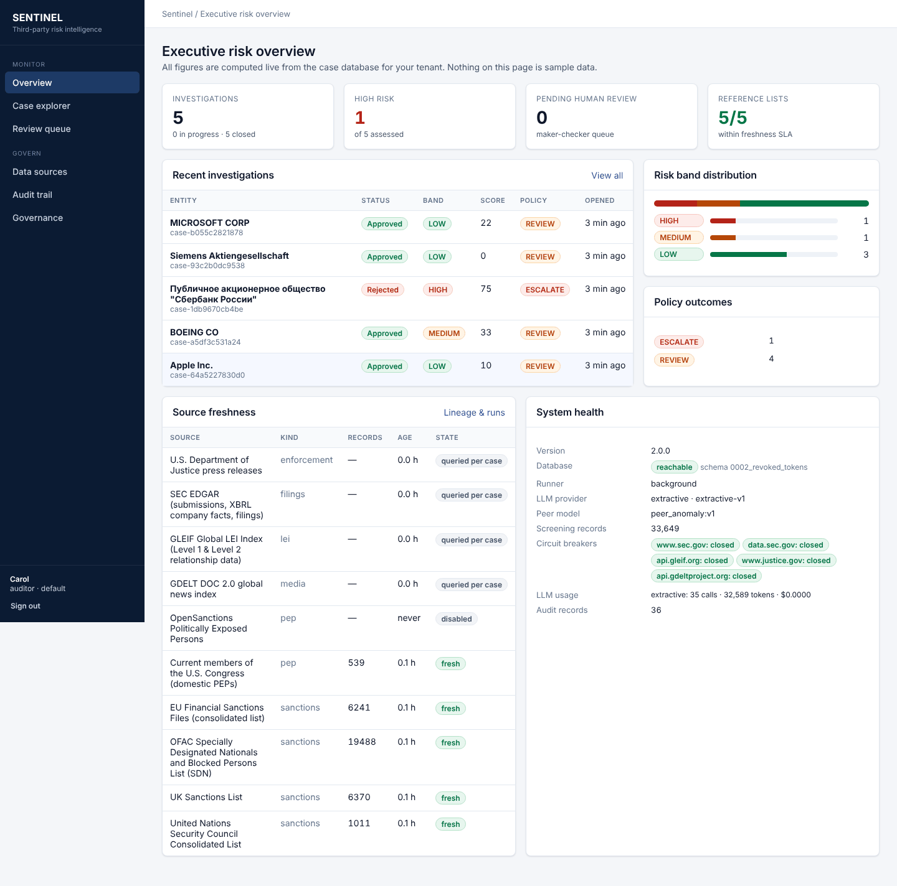
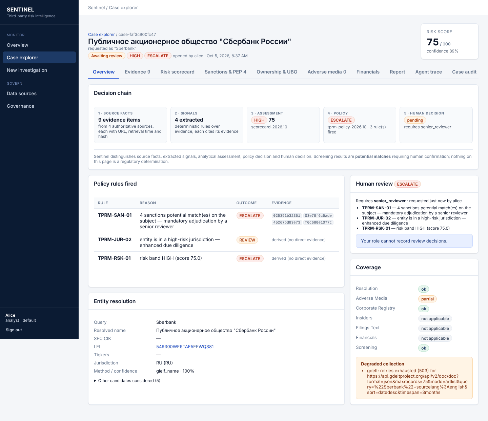
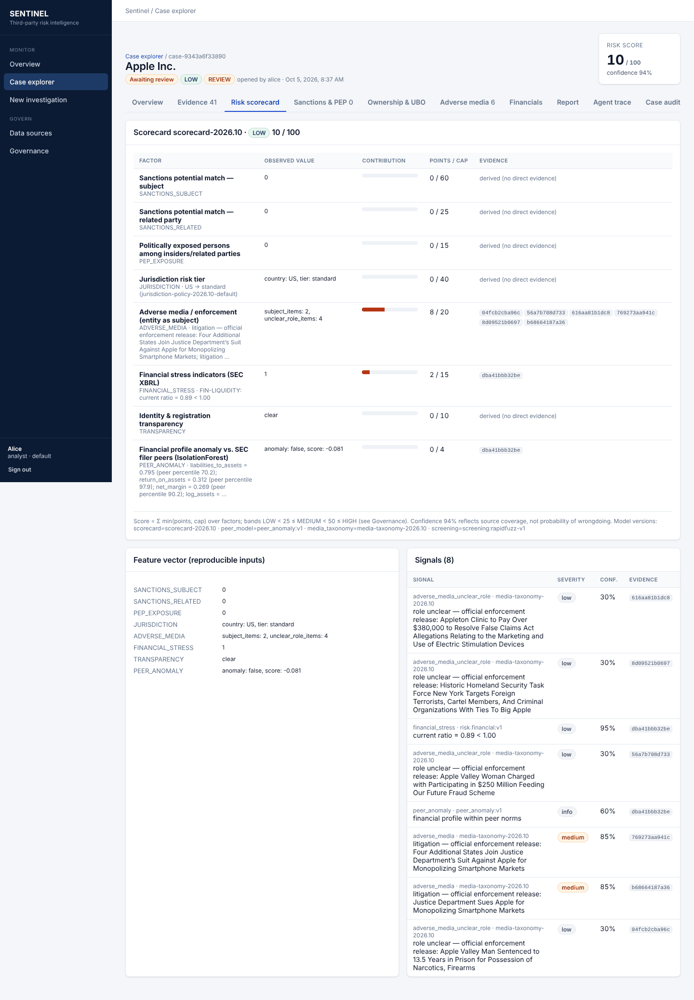
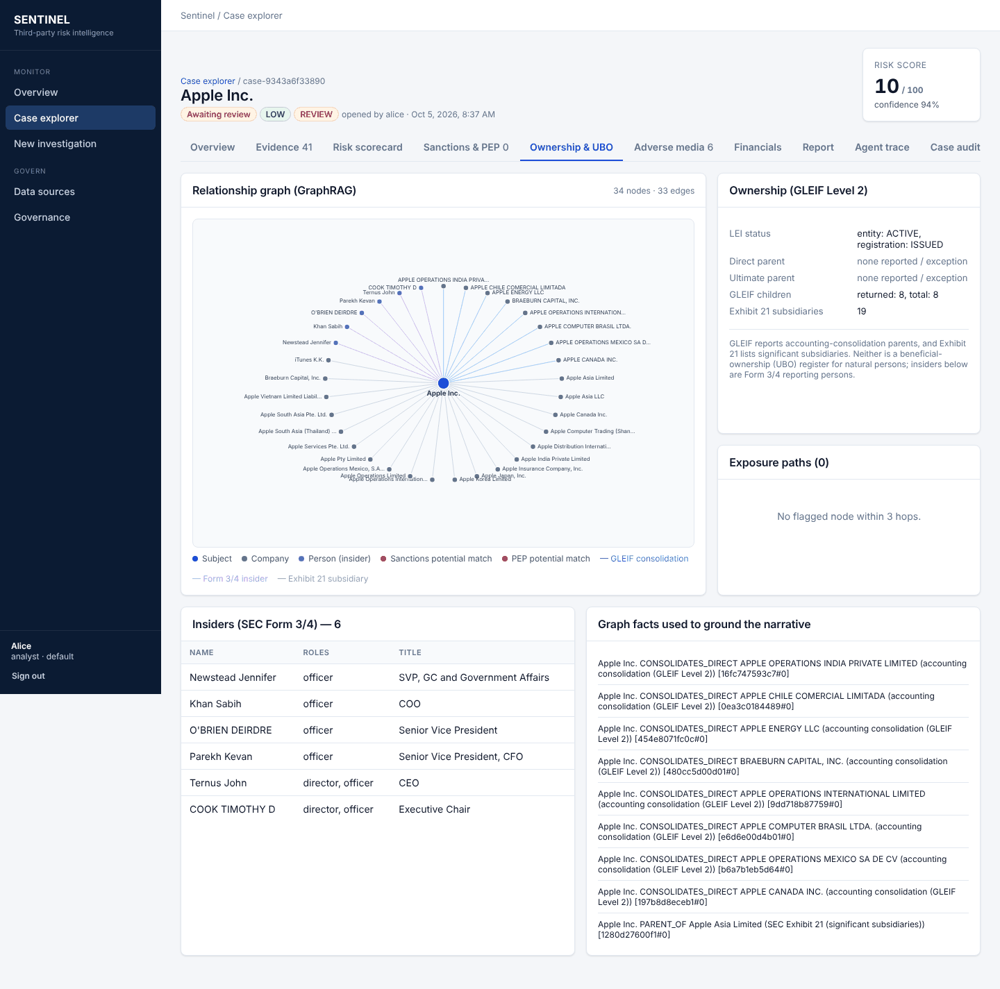
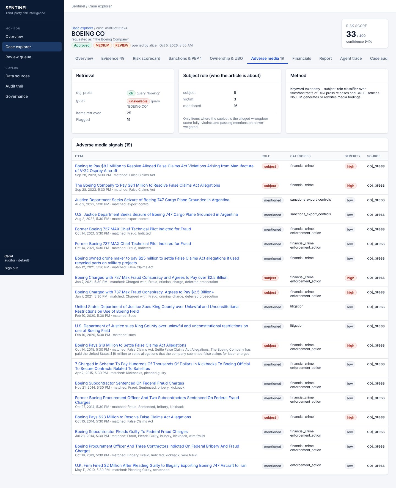
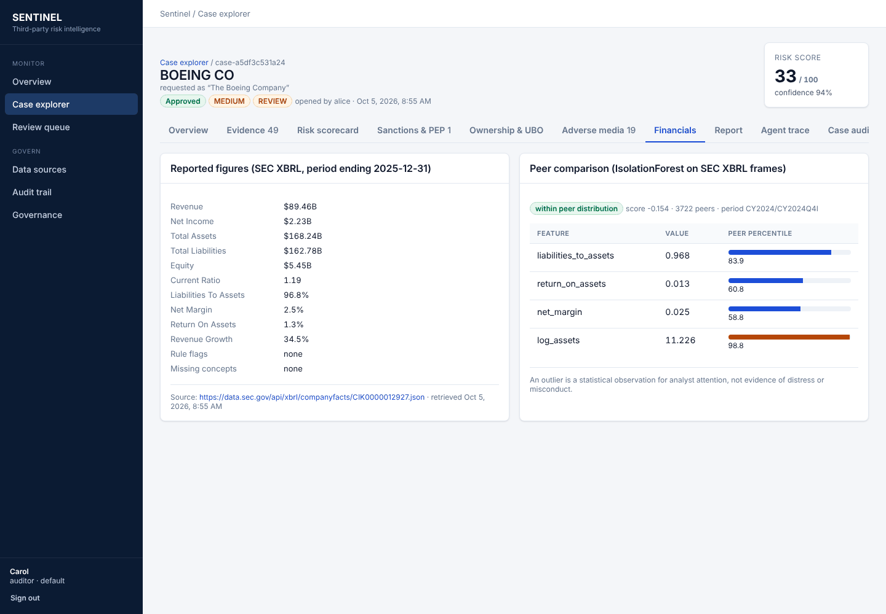
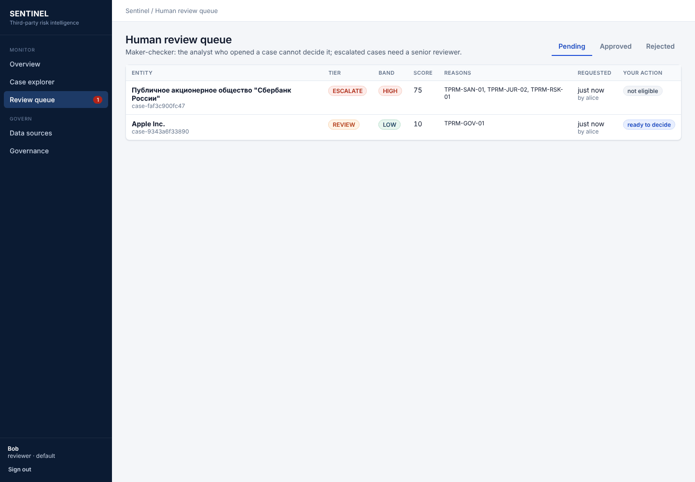
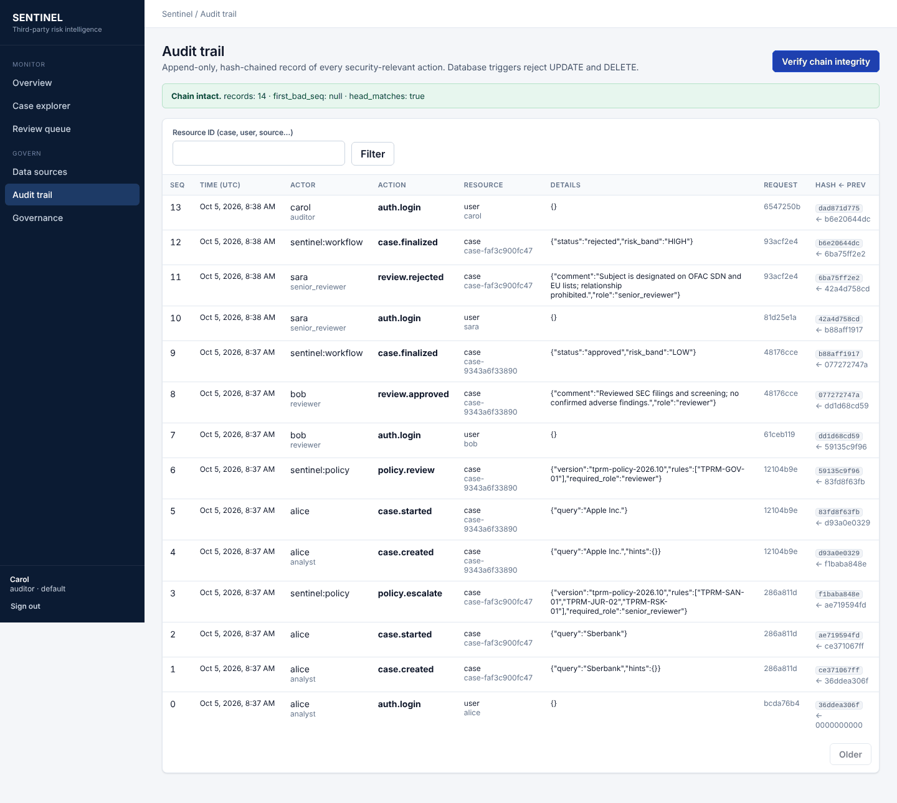

# Analyst dashboard

React 19 + TypeScript (Vite) single-page app in `dashboard/`, served by the API at `/` once built
(`npm ci && npm run build` → `dashboard/dist`). It calls only the `/api/v1` endpoints, so everything it shows is
live data from the database; there are no sample figures. The page is CSP-compatible (`script-src 'self'`, no inline
scripts) and renders source text with React escaping and a custom Markdown renderer (no raw HTML injection).

Screenshots below come from the browser end-to-end test (recorded real data) and from the live PostgreSQL run of
2026-10-04.

## Pages

| Page | Who | Content |
|---|---|---|
| **Sign in** | all | username/password; session in `sessionStorage`, cleared on expiry or 401 |
| **Overview** | all | investigations by status, high-risk count, pending reviews, reference-list freshness, recent cases, band and policy-outcome distribution, system health (auditor/admin) |
| **New investigation** | analyst | legal name, optional CIK/LEI/ticker and research question; idempotency key per form; redirects to the live case page |
| **Case explorer** | all (scoped) | search/filter by status and band, paging, auto-refresh while cases run |
| **Case workspace** | all (scoped) | live progress while running; tabs below |
| **Review queue** | reviewer, senior reviewer, auditor | pending/approved/rejected; eligibility per item (maker-checker, tier) |
| **Audit trail** | auditor | hash-chained records with paging and resource filter; **Verify chain integrity** |
| **Data sources** | all | source registry with authority, licence, SLA, freshness, last run; ingestion runs with data-quality details; refresh button (admin) |
| **Governance** | all | policy/scorecard/peer-model/LLM versions, thresholds, jurisdiction policy, agent contracts, source catalogue |

### Case workspace tabs

| Tab | Shows |
|---|---|
| Overview | decision chain (source facts → signals → assessment → policy → human decision), policy rules with evidence chips, entity resolution with candidates, coverage and degraded-collection errors, review panel |
| Evidence | every evidence item with source, retrieval time, locator, confidence, link to the source, and **Lineage & integrity** (document hash and raw-copy verification) |
| Risk scorecard | factor table (value, rules, points/cap, evidence), feature vector, model versions, signals |
| Sanctions & PEP | potential matches per list with programmes and method, names screened, list versions used and their age |
| Ownership & UBO | evidence-backed relationship graph (GLEIF consolidation, Exhibit 21, Form 3/4 insiders), exposure paths to flagged parties, insiders, GLEIF Level 2 details, explicit UBO-limitation note |
| Adverse media | retrieval status per source, subject-role breakdown, items with role, categories, severity and source link |
| Financials | XBRL figures and ratios with source URL; peer comparison with percentiles |
| Report | cited due-diligence memo with grounding score; research Q&A with citations |
| Agent trace | node-by-node execution (status, duration, details, errors), LLM usage for the case |
| Case audit | audit records for the case (auditor) |

### Review panel

Shows tier, required role, reasons (rule ids) and who requested the review. If the current user may decide, it
asks for a rationale (≥ 10 characters) and offers **Approve relationship** / **Reject relationship**. Otherwise it
states why not (role, segregation of duties, escalation tier). After a decision it shows the immutable decision
record.

## Screenshots

| | |
|---|---|
|  |  |
|  |  |
|  |  |
|  |  |

## Development

```bash
cd dashboard
npm ci
npm run dev          # Vite dev server on :5173, proxies /api to http://localhost:8000
npm run typecheck
npm run build
```

Browser e2e: `pytest tests/e2e/test_dashboard.py` (needs the build and `python -m playwright install chromium`);
`SENTINEL_E2E_SCREENSHOTS=<dir>` saves screenshots of each step.
