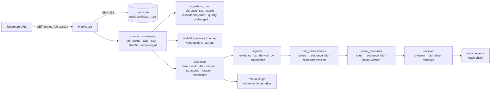

# Data lineage and data quality

## Lineage chain

* Every evidence item has a `document_id`; `GET /api/v1/documents/{id}` returns URL, retrieval time, hash, size and
  whether the raw bytes are present and match (`integrity_verified`). The dashboard's **Lineage & integrity**
  button on each evidence item calls it.
* Signals, scorecard factors and policy rules list the evidence ids they rely on; the dashboard renders them as
  citation chips with the evidence title and URL.
* Report and research answers cite `[evidence-prefix#chunk]`; the grounding check verifies that each cited chunk
  exists in the case and supports the sentence.
* Assessments store the scorecard version, the feature vector and model versions (`peer_model`, `media_taxonomy`,
  `screening`), so the score can be recomputed from persisted data.

## Data-quality controls

| Stage | Control |
|---|---|
| HTTP | status-code handling (404 = authoritative absence, not retried; 408/425/429/5xx retried), timeouts, breaker |
| Reference lists | parser per official format; records without a usable name rejected and counted; duplicates removed; shrink gate (> 20 % drop refuses the new version and keeps the current one); unchanged content detected by version key (no new version); last 3 versions kept |
| Freshness | per-source SLA; `stale` computed from the last successful retrieval; stale sanctions lists force REVIEW (TPRM-DAT-03) and are listed per case |
| Entity resolution | EDGAR/GLEIF corroboration, confidence, ambiguity flag; low confidence → TPRM-DAT-02 |
| Financials | XBRL concept fallbacks per indicator; missing concepts listed (no imputation); peer model refuses rows with missing inputs |
| Adverse media | taxonomy + subject-role; unclear-role items are kept as low-confidence signals, not scored as subject |
| Dates | publication dates normalised to ISO-8601 UTC (DOJ epoch seconds, GDELT `YYYYMMDDTHHMMSSZ`); unknown formats kept verbatim |
| Normalisation | names re-normalised at index load, so normaliser changes apply to lists loaded by older versions |

## Idempotency

* `POST /api/v1/cases` with `Idempotency-Key` returns the existing case for the same key and user.
* Reference loads with unchanged content produce a run with `unchanged=true` and no new list version.
* Per-entity source responses within `SOURCE_CACHE_TTL_S` are reused from the raw store (same document id).
* Retrying a failed case resumes the LangGraph checkpoint under a new attempt number; evidence from earlier attempts
  stays attached to the case.

## Retention

Raw documents and list versions are retained; the reference loader keeps the last three list versions'
entries. Case data and audit records are never deleted by the application (the audit table rejects deletes). Define
a retention schedule per your record-keeping obligations before production use; see
[disaster_recovery.md](disaster_recovery.md).
